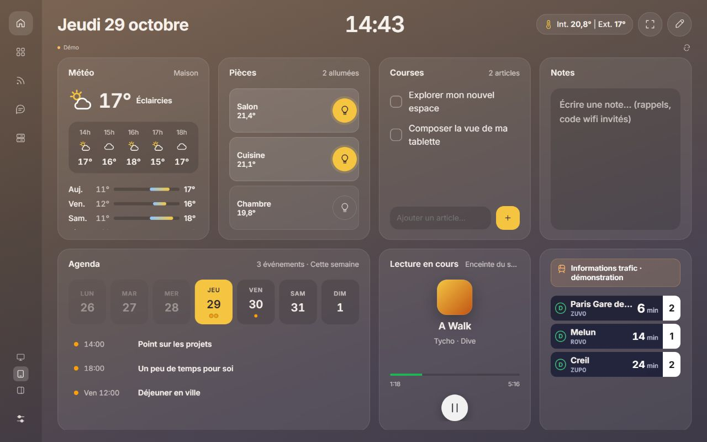

# Cockpit — prototype local

Cockpit rassemble la maison, la veille et les agents dans une seule application. Interface en français, bibliothèque de **23 modules**, cinq espaces et trois dispositions indépendantes : bureau, tablette et compact.

Dans **Paramètres → Apparence de toute l’application**, choisir **Graphite** ou **Verre**. Le thème change uniquement les couleurs, les polices et le fond : tailles, positions, navigation et mode édition restent identiques. Le profil Tablette garde sa grille sous les deux thèmes ; Bureau et Compact gardent leur colonne sous les deux thèmes. Le choix est conservé dans chaque navigateur et inclus dans les exports de disposition. Les feuilles de style des deux projets sont copiées sans modification dans `public/design/`. Le prototype ne charge plus le premier habillage pastel.



## Lancer

Node.js 22 ou ultérieur. Le serveur n’a aucune dépendance à installer.

```powershell
npm start
```

Ouvrir **http://127.0.0.1:3888**. `PORT` permet de choisir un autre port.

Pour la version bureau : double-cliquer **Ouvrir Cockpit.cmd**, ou exécuter :

```powershell
npm run desktop
```

Le lanceur utilise Electron déjà installé dans le dossier voisin `FeedMe/node_modules`. Il ne lance pas Cockpit et ne modifie pas ses fichiers. Sans cette installation, utiliser la version web ou installer Electron dans ce projet avec `npm install --no-save electron`.

## Explorer

- Le premier démarrage est en **mode démo**, signalé dans l’en-tête et sur les modules. Articles, mesures, équipements, musique et conversations sont fictifs. Aucune commande HA ni requête vers un agent n’est envoyée dans ce mode.
- **Personnaliser** : le thème Verre reprend l’éditeur d’origine : maintien au doigt puis glissement pour échanger deux cartes, poignées sur les bords et le coin pour redimensionner de 1 à 4 colonnes/lignes, flèches du clavier sur la poignée. Les outils du haut donnent accès à **Fond / Module / Terminé**. L’en-tête se compose par glissement entre trois zones. Ses réglages reprennent les pastilles de couleur, boutons de taille, aperçus des polices et formats de date/heure de Cockpit. Les cartes disposent aussi de boutons de dimensions et de couleurs. Les choix restent en brouillon jusqu’à **Enregistrer** ; **Annuler**, Échap et la fermeture de la fenêtre les abandonnent. Fond, accents et en-tête sont inclus dans l’export. Le plein écran et son retour automatique au premier toucher se règlent dans les paramètres de cet appareil. La grille s’ajuste à la hauteur disponible, y compris en plein écran. Dans la disposition en colonne, déplacer les cartes à la souris ou au clavier. Sur bureau/Brave, les widgets conservent la colonne Cockpit et peuvent se replier par le bouton ou un double-clic sur leur en-tête. La configuration permet de choisir une entité HA.
- **Ajouter un module** : bibliothèque filtrable par univers et par recherche. Plusieurs instances d’un même module sont possibles.
- **Agrandir** : ouvrir le même module dans une vue détaillée.
- **Paramètres → Onglets visibles par écran** : cocher les espaces à afficher séparément sur Bureau, Tablette et Compact. Masquer un onglet conserve ses modules ; au moins un onglet reste visible. Le compact commence avec Mon bureau et Agents. Ces choix sont locaux au navigateur et inclus dans les exports.
- Les dispositions **Bureau / Tablette / Compact** sont enregistrées séparément, pour chaque espace et dans chaque navigateur. Elles ne se synchronisent pas entre appareils.
- Notes et tâches appartiennent au prototype, sont stockées dans le navigateur et restent distinctes des données Cockpit. L’export/import dans les réglages permet de les sauvegarder avec les dispositions.

## Connecter les données réelles

### Cockpit

1. Lancer normalement Cockpit sur le même PC.
2. Cliquer sur **Mode démo**, ou **Connecter mes données**.
3. Le serveur détecte Cockpit sur ses ports locaux 3777 à 3782.

Le prototype lit les articles, collections, calendrier, état Spotify, métriques, quotas et résumés des conversations par l’API de Cockpit. Il ne lit ni ne copie les fichiers contenant des secrets.

Le chat utilise les **conversations existantes**. Un envoi réel transmet le message à l’agent et rejoint son historique Cockpit. Le prototype ne crée pas de connexion ni de conversation : ces opérations restent dans Cockpit. La lecture détaillée d’un historique peut déclencher la synchronisation normale de Cockpit avec sa passerelle. Aucun message réel n’a été envoyé pendant les vérifications du prototype.

### Home Assistant sur le PC

Dans **Connexions & réglages**, renseigner l’adresse HA et un jeton longue durée. L’adresse suggérée provient du script de déploiement du projet Cockpit. Le jeton saisi est conservé **uniquement en mémoire**, jusqu’au rechargement de la page. La connexion se fait directement du navigateur à HA, via le client WebSocket repris du projet initial.

Les commandes réelles d’éclairage, thermostat, scènes, prises, ventilateurs, automatisations et scripts partent seulement lorsque l’utilisateur appuie sur le contrôle correspondant, en données réelles. Les droits restent ceux du compte HA utilisé. Les registres des pièces peuvent nécessiter un compte administrateur.

Les calendriers HA utilisent également son API HTTP : hors de l’origine HA, les réglages CORS de HA doivent permettre cette lecture. Une page HTTPS ne peut pas accéder à un HA HTTP.

## La tablette : publication automatique

Version publiée : **http://192.168.1.251:8123/local/maison/metaboard/index.html**.

**Conserver `index.html` à la fin de l’adresse** : Home Assistant répond 403 à une adresse de dossier seule (`/metaboard/`). Le démarrage fonctionne aussi sur l’adresse HTTP du réseau local.

Le dashboard original reste disponible sur **http://192.168.1.251:8123/local/maison/index.html**.

Pour publier les prochaines modifications, double-cliquer **publier.cmd**, ou lancer `npm run deploy:tablet`. Le script exporte les fichiers, les vérifie, puis utilise le dépôt et le déploiement Cockpit existants dans une copie de travail isolée. Il publie Cockpit dans son propre sous-dossier, sans remplacer les fichiers de l’interface originale. Chaque fichier servi est ensuite vérifié. Le dernier résultat est conservé dans `.deploy/latest.json`.

La tablette recherche une nouvelle version toutes les deux minutes et au retour sur la page. Le rechargement attend la fermeture des fenêtres de réglages et la fin de la saisie. Aucun déploiement PC n’est nécessaire pour utiliser la maison sur tablette.

`npm run export:tablet` reste disponible pour générer uniquement les fichiers dans `dist/tablet`.

Dans les réglages, **Utiliser ma session Home Assistant** réutilise la session du parent HA, une session propre au prototype ou celle du navigateur, suivant le mécanisme déjà utilisé dans Cockpit. Une connexion OAuth propre au prototype peut être conservée dans ce navigateur ; ses clés sont distinctes (`mb.oauth`) de celles de Cockpit. Le jeton longue durée saisi manuellement, lui, n’est pas enregistré.

**Limite de cette étape :** la version servie par HA donne accès à la maison et aux modules locaux sans dépendre du PC. Les données RSS/agents/Spotify/métriques Cockpit restent disponibles sur le PC via le service local. Une passerelle authentifiée entre appareils n’est pas encore développée. Le serveur PC écoute volontairement sur la boucle locale : ce n’est pas une version de production accessible sur tout le réseau.

Le profil tablette se teste également immédiatement avec le bouton Tablette dans l’application PC ; ce bouton change la disposition et les dimensions tactiles, pas la machine qui héberge les services.

## Le panneau Brave

1. Double-cliquer **Cockpit pour Brave.vbs**, ou lancer `npm run browser`.
2. Pour une première installation, charger `extensions/brave/` comme extension non empaquetée dans Brave. Pour mettre à jour une installation existante, utiliser son bouton **Actualiser** dans la page des extensions.
3. Cliquer sur son bouton pour ouvrir le panneau latéral.

Le service tourne en arrière-plan : fermer la fenêtre bureau ne l’arrête plus. Le lanceur bureau démarre également ce service automatiquement. L’extension 0.2.0 détecte le service sur le port 3888, affiche un état de connexion et propose une nouvelle tentative si le service est absent. Elle demande `sidePanel` et l’accès aux adresses locales du PC pour cette détection ; elle ne lit pas les pages visitées.

La publication tablette est indépendante du service PC. Pour les données Cockpit réelles sur PC, Cockpit doit également être lancé.

## Projets et tâches confiées aux agents

L’onglet **Projets** (bureau et tablette) regroupe des projets personnels : grille de projets (statut, priorité, échéance, progression, tâches en cours / bloquées / à valider) et tableau Kanban **À faire · En cours · Bloqué · À valider · Terminé**. Chaque projet porte un contexte (objectif, instructions, ressources, liens, dépôt, environnement) transmis aux agents quand la tâche le demande.

- **Aucun lancement implicite.** Créer une tâche, assigner un agent ou déplacer une carte ne lance rien. Seul le bouton **Lancer** (ou « Répondre et lancer », « Lancer la reprise », « Relancer ») démarre une exécution.
- **Connexion utilisée.** Les exécutions passent par la connexion OpenClaw déjà configurée dans Cockpit (routes `agents/conversations`). Aucune seconde connexion, aucun secret côté navigateur. Une conversation dédiée est créée par tâche et réutilisée pour les reprises.
- **Suivi.** Le serveur du PC tient lui-même le flux de l’agent : un rafraîchissement de page ne coupe rien. Une tâche ne passe « En cours » qu’après confirmation du démarrage. Après un redémarrage, l’état est relu dans l’historique OpenClaw, sans renvoyer la demande. Une clé de lancement empêche les doublons (double clic, nouvelle tentative réseau).
- **Résultat.** L’agent termine par une ligne `STATUT: TERMINÉ`, `STATUT: BLOQUÉ` (question) ou `STATUT: ÉCHEC`. C’est une convention de consignes, pas une fonction OpenClaw : sans ligne de statut, la réponse est traitée comme un résultat à valider et le signale.
- **Limite connue : pas d’arrêt.** La connexion OpenClaw de Cockpit n’autorise pas `chat.abort` ; l’interface l’indique au lieu de proposer un faux bouton Stop.
- **Actions sensibles.** Les autorisations d’OpenClaw restent en vigueur. Les consignes demandent en plus à l’agent de s’arrêter en `BLOQUÉ` et de décrire l’action concrète avant toute publication, envoi externe, suppression destructive, déploiement ou dépense non prévus.

Les données sont dans `data/projects.json` (hors dépôt). Après mise à jour, **relancer le service MetaBoard** pour activer les routes `/api/projects/*`.

### Accès des agents (Claude, Codex, OpenClaw)

Un agent peut créer et modifier des projets et des tâches, changer une tâche de colonne et archiver un projet quand on le lui demande. Il **ne peut pas** lancer une exécution, valider un résultat ni supprimer : ces gestes restent dans l’interface. Il ne peut pas non plus passer « En cours » une tâche confiée à OpenClaw, ni modifier une tâche pendant une exécution. Chaque création indique son auteur (« créée par Claude »).

- **Point d’accès.** `http://127.0.0.1:3890/agent/v1/` et l’adresse Tailscale du PC sur le même port (jamais le réseau local ni Internet). Une clé par agent dans `data/agent-access.json` (hors dépôt). Pour révoquer une clé, supprimer son entrée puis relancer le service : une nouvelle clé est générée.
- **Dépôt GitHub obligatoire pour un projet créé par un agent** (`https://github.com/<compte>/<dépôt>` seulement ; les projets créés à la main restent libres). Toute adresse GitHub est clonée sur ce PC dans le dossier parent de MetaDashBoard (`Projets DEV`, ou `COCKPIT_WORKSPACES`), sans invite d’identifiants ; un dossier existant n’est réutilisé que s’il contient déjà ce dépôt, jamais écrasé. En cas d’échec, l’erreur s’affiche avec un bouton « Réessayer ».
- **Agent du projet** : les nouvelles tâches lui sont confiées par défaut. Cockpit ne crée pas d’agent lui-même : sur un projet sans agent, le bouton « Créer l’agent OpenClaw » (après confirmation) envoie le contexte du projet à l’agent principal d’OpenClaw, qui crée l’agent dédié ; Cockpit l’associe dès qu’il apparaît sur la passerelle (abandon affiché après 30 minutes ou en cas de refus). Un projet créé par OpenClaw via sa compétence a déjà son agent.
- **Pièces jointes** : captures (collées avec Ctrl+V), PDF, zip, textes ; 10 Mo par fichier, 20 par tâche, contenu vérifié. Stockées dans `data/attachments/` (hors dépôt), listées dans les consignes envoyées à l’agent avec leur chemin sur le PC. Un agent peut en ajouter, pas en retirer.
- **Claude Code et Codex** : serveur MCP local `mcp/cockpit-projets.cjs --client claude|codex` (outils `projets_ici` — projet du dossier courant et ses tâches —, `projets_lister`, `projets_agents`, `projets_tache`, `projets_creer_projet`, `projets_modifier_projet`, `projets_creer_tache`, `projets_modifier_tache`, `projets_joindre_fichier`). Déjà inscrit dans la configuration utilisateur de Claude Code et dans `~/.codex/config.toml`.
- **OpenClaw** (sur le VPS) : `npm run agents:openclaw-skill` génère `data/openclaw-skill/cockpit-projets/SKILL.md` (adresse Tailscale + clé OpenClaw). Copier ce dossier dans `~/.openclaw/skills/` sur le serveur OpenClaw (partagé par tous ses agents, fichier en `chmod 600`). Installé le 30/10/2026. La compétence décrit la création complète : dépôt GitHub (créé privé par OpenClaw avec ses propres accès), agent dédié avec son contexte dans `AGENTS.md`, projet Cockpit, copie locale.
- **ChatGPT (web ou application)** : non pris en charge. Ses connecteurs exigent une adresse HTTPS publique, et Projets ne s’ouvre pas à Internet.

## Couverture et limites

La grille des pièces, leurs compteurs et les réglages d’appareils reprennent le dashboard initial. Le mode démo est retiré. Le [suivi de la reprise](docs/PARITY.md) détaille les composants réintégrés et les vérifications restantes.

Les composants complets Cockpit utilisent son backend sur ce PC. Le lanceur Cockpit démarre Cockpit en arrière-plan. Les paramètres donnent accès aux réglages RSS/OPML, Spotify, IA, agents et abonnements.

Sur tablette, l’URL reste la même. Après connexion avec la session administrateur HA, le relais authentifié du PC permet d’accéder également aux services Cockpit. PC et Cockpit doivent rester actifs pendant cette phase de test ; le déploiement serveur permanent est reporté.

Les dispositions, notes et préférences Cockpit se synchronisent dans une clé séparée du compte Home Assistant, sans réécrire l’ancien dashboard. Les pages originales peuvent être reprises depuis les paramètres. Les préférences locales de l’ancienne interface Cockpit sur une autre origine navigateur ne sont pas migrées automatiquement.

La fenêtre Windows comporte des contrôles de dock, AppBar, masquage, premier plan et notifications sur activation ; leur validation Windows complète reste à faire. Aucun nouvel installateur autonome ni publication d’extension sur le magasin n’est fourni.

## Architecture

```text
public/core.js        utilitaires d’affichage et stockage local
public/design/        feuilles de style originales FeedMe et HomeDashboard
public/shell.js       structures de navigation des profils
public/preferences.js séparation thème / disposition et visibilité des onglets par profil
public/themes.css     couleurs, polices et fonds sans règles de disposition
public/module-settings.js commandes visuelles de configuration, sans écriture avant validation
public/module-settings.css présentation du dialogue HomeDashboard sous les deux thèmes
public/native-renderers.js structures de widgets et pont avec les rendus HA originaux
public/data.js        sources : démo, FeedMe, Home Assistant
public/modules.js     catalogue, rendus et dispositions initiales
public/app.js         navigation, composition, réglages et chat
public/projects.js    onglet Projets : grille, Kanban, panneau de tâche
projects.cjs          projets, tâches et suivi des exécutions OpenClaw côté serveur
workspace.cjs        clone des dépôts GitHub des projets sur ce PC
attachments.cjs      pièces jointes des tâches (data/attachments/)
public/styles.css     présentation et adaptations aux écrans
public/vendor/ha.js   client HA repris de HomeDashboard
public/vendor/auth.js connexion par session HA adaptée au prototype
public/vendor/home-*  icônes, modèle et catalogue de rendus HomeDashboard
server.js             fichiers statiques + passerelle locale FeedMe restreinte
desktop.cjs           fenêtre Electron sans accès Node dans l’interface
extensions/brave/     panneau latéral pointant vers la version compacte
```

Les modules reçoivent un contexte commun. Le choix de la source est distinct du choix de disposition. Cette séparation sert à tester la convergence sans fusionner les deux gros contrôleurs des applications existantes.

Les détails de provenance et les prochaines extractions sont dans [ORIGINS.md](ORIGINS.md).

## Vérification

```powershell
npm test
```

Les tests contrôlent le service statique, les tentatives de lecture hors du dossier public, les requêtes venant d’une autre origine et la liste des opérations Cockpit autorisées. Les contrôles syntaxiques et les essais visuels couvrent également les modules, la bibliothèque, les interactions simulées et les trois profils. L’intégration HA réelle nécessite votre connexion ; aucune commande sur la maison n’a été effectuée lors de cette création.
